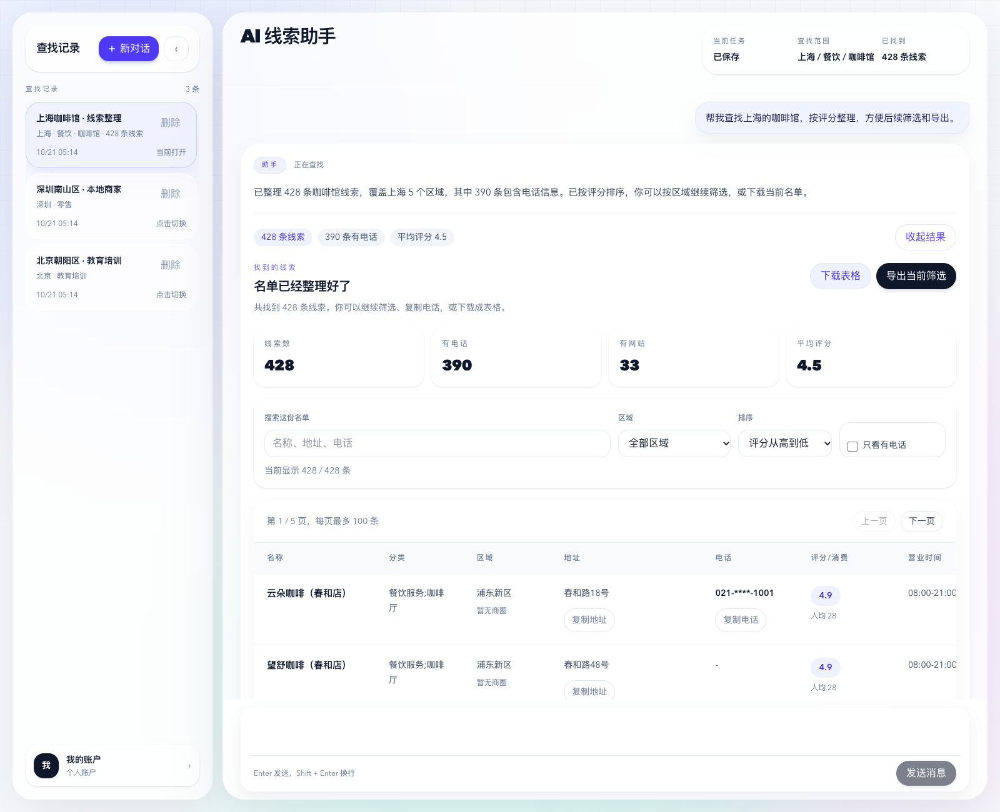
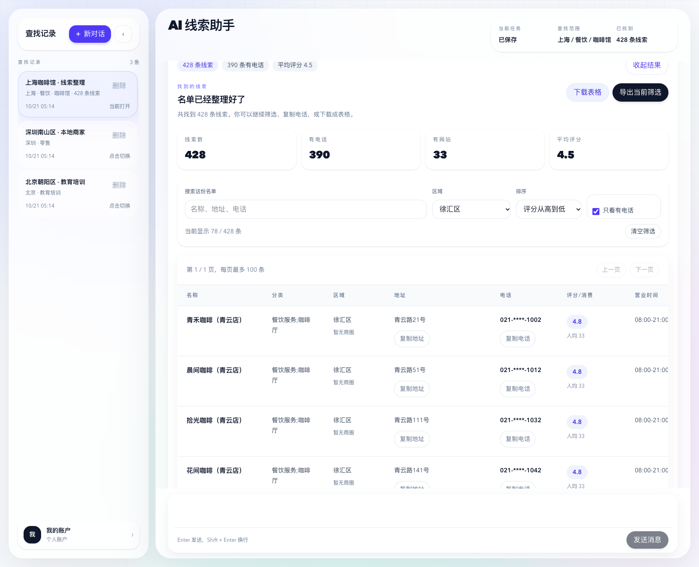

# AI 线索助手 · Map AI Leads Agent

本项目采用 [GNU AGPL-3.0](LICENSE) 开源，允许商业使用。修改后通过网络提供服务时，须按许可证向使用者提供该版本的对应源码获取方式。

面向地图数据接入的 AI 线索 Agent，使用 **Next.js、DeepSeek 和 SQLite** 构建。用中文描述目标城市、区域和行业，查找公开 POI 数据，在工作台继续筛选、保存会话并导出 CSV。

当前版本已实现 **高德地图 Web Service API** 接入，其他地图服务尚未实现。地图服务的扩展方向不影响现有版本的配置方式：运行检索仍需提供高德 Key。

## 系统演示

### 首页


### 对话与线索结果



### 筛选与导出



## 功能

- **自然语言查找**：DeepSeek 解析用户意图，后端校验并执行搜索、筛选、排序、汇总与导出动作。
- **多轮对话**：继续补充区域、行业和筛选条件，需要确认的计划经确认后执行。
- **线索表格**：按名称、地址、电话搜索，按区域、电话是否可用和评分筛选或排序。
- **会话持久化**：SQLite 保存账号、对话、检索任务和结果，刷新后可继续。
- **账号隔离**：Web 工作台使用密码登录与 Cookie 会话，接口按用户校验会话归属；首次使用新账号登录时自动创建账号。
- **干净 CSV**：默认导出名称、分类、区域、地址、电话、评分/消费、营业时间，支持导出当前筛选结果。
- **公开展示页面**：包含首页、功能、价格、博客、FAQ、联系及法律说明页。

## 快速开始

需要 Node.js **20.9 或更高版本**，建议使用 Node.js 22。实际检索需要自行申请高德 Web Service Key 和 DeepSeek API Key。

```bash
git clone https://github.com/lorin-code/map-ai-leads-agent.git
cd map-ai-leads-agent
npm ci
npm --prefix web ci
cp .env.example .env.local
```

在 `.env.local` 中填写自己的配置：

```dotenv
AMAP_KEY=your_amap_web_service_key
DEEPSEEK_API_KEY=your_deepseek_api_key
DEEPSEEK_BASE_URL=https://api.deepseek.com
DEEPSEEK_MODEL=your_available_model_id
SQLITE_PATH=data/app.db
NEXT_PUBLIC_SITE_URL=http://127.0.0.1:3005
NEXT_PUBLIC_SOURCE_URL=https://github.com/lorin-code/map-ai-leads-agent
```

`DEEPSEEK_MODEL` 应填写你的服务商当前支持的模型 ID；环境模板中的值可自行替换。`SQLITE_PATH` 相对于项目根目录解析，数据库会在运行时自动创建。

```bash
npm start
```

打开 <http://127.0.0.1:3005>，通过登录入口创建自己的账号并进入 `/app`。首页可以在未配置 API Key 时浏览，实际对话检索需要有效配置和服务商额度。

## 常用命令

| 命令 | 用途 |
| --- | --- |
| `npm start` | 启动开发服务器，默认 `127.0.0.1:3005` |
| `npm test` | 运行后端与工具测试 |
| `npm run web:typecheck` | 检查前端 TypeScript |
| `npm run web:build` | 构建生产版前端 |
| `npm --prefix web start` | 启动已构建的生产版前端 |

开发与构建命令会先清理 `web/.next`，请勿同时运行开发服务器和生产构建。

## 项目结构

```text
server/
  agent/             DeepSeek 动作校验、Agent 编排与工具执行
  auth/              密码与登录会话管理
  bin/               命令行入口
  db/                SQLite 初始化与会话存储
  integrations/      高德地图 API 客户端
  routes/            Node.js 后端路由
web/
  app/               Next.js 页面与 API 路由
  components/        公开页面与工作台组件
  lib/               前后端辅助模块
  scripts/           环境加载与启动辅助脚本
test/                node:test 自动化测试
docs/screenshots/    脱敏演示截图
```

Web 用户通过 `/app` 进入 Agent 流程，由 DeepSeek 提供意图，再由工具执行搜索策略。CLI 是独立的单次文本搜索工具，不调用 DeepSeek，也不保存工作台会话，二者参数默认值和检索范围不同。

## CLI

CLI 不会自动读取 `.env.local`，使用 Node.js 的环境文件参数加载配置：

```bash
node --env-file=.env.local server/bin/amap-leads.js \
  --city 上海 \
  --keywords 咖啡 \
  --json exports/shanghai-coffee.json \
  --csv exports/shanghai-coffee.csv
```

```bash
node server/bin/amap-leads.js --help
```

CLI 可写出原始 JSON 用于本地调试；Web 工作台面向用户只提供精简 CSV 下载。

## 数据与部署

- 本仓库不包含 API Key、账号数据库、真实会话、实际商家名单、导出文件或内部设计文档。`.env.example` 仅包含配置模板。
- `/api/agent/*` 为工作台接口，Next.js 路由已有登录和会话归属校验。`server/app.js` 是独立的后端开发入口，部署时不要将其作为未经鉴权的公开 API 暴露。
- `/api/public/activity` 仅返回展示用活动摘要，不包含会话 ID、聊天内容、原始查询参数、线索明细或下载链接；摘要仍可能包含城市、区域、行业和数量，公开运营时应确认这种展示符合用户预期。
- 生产部署前配置 HTTPS、访问限制、请求限流、注册策略、配额控制和数据库备份，并根据实际运营方调整公开页面中的价格、联系方式和法律条款。
- 数据来自高德地图公开接口，覆盖范围、准确性和调用额度受服务商限制。使用前请确认 API 服务条款、数据授权及适用的隐私要求。

## 贡献与许可

欢迎通过 [Issues](https://github.com/lorin-code/map-ai-leads-agent/issues) 报告问题或提交 Pull Request。提交前运行 `npm test` 和 `npm run web:typecheck`；涉及前端的修改请附截图。

Copyright (c) 2026 lorin-code。本项目代码按 [GNU Affero General Public License v3.0 only](LICENSE)（SPDX：`AGPL-3.0-only`）授权，允许商业使用、修改和分发。

分发受本许可证覆盖的程序时，须按 AGPL-3.0 提供对应源码并保留版权和许可声明。修改后通过网络提供交互服务时，也必须向所有远程交互用户显著提供免费获取该修改版对应源码的机会；是否收费不影响这些义务。具体范围和条件以许可证全文为准。

公开页面页脚和工作台标题旁提供“源代码”入口，默认指向本仓库。部署修改版时，使用 `NEXT_PUBLIC_SOURCE_URL` 指向实际部署版本的公开源码、标签或下载地址；对应源码应包含许可证要求的构建和运行所需材料，不能仅链接到未包含自己修改的上游版本。该变量在前端构建时写入，修改后需要重新构建。

本软件不提供任何担保。第三方依赖与地图数据分别遵循其原有许可证及服务条款。
